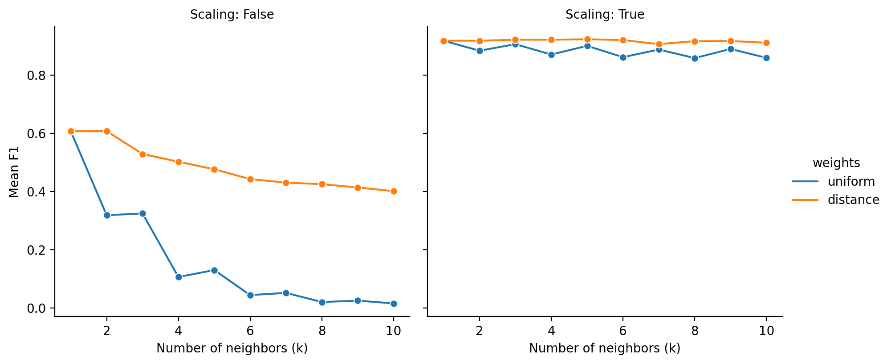
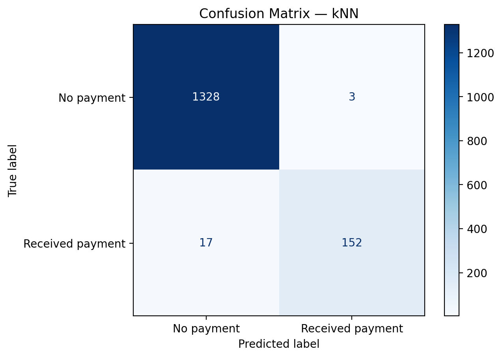
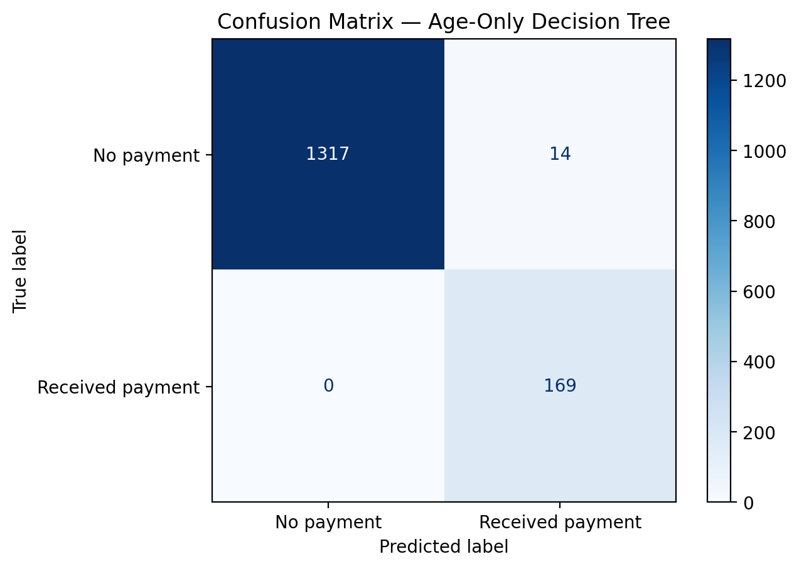

[English](README.md) | [Português (Brasil)](README.pt-BR.md)

# Insurance Analytics & Matrix-Based Data Obfuscation

**TripleTen Data Science Bootcamp | Sprint 11 Project**

## Project Overview

This project examines how data analysis, machine learning, and linear algebra can support four analytical tasks for **Protect Your Tomorrow (*Proteja Seu Amanhã*)**, a fictional insurance company.

Using policyholder characteristics and the number of insurance benefit payments recorded over the preceding five years, the project investigates how to **identify similar customers, classify historical payment receipt, estimate payment counts, and transform personal data without degrading linear regression predictions**.

The fourth task focuses on an invertible matrix transformation that makes the original features less directly interpretable while retaining their predictive information. It demonstrates a mathematical property of ordinary least-squares regression—not an encryption or production-ready privacy solution.

## Results

The experiments show that **feature scaling substantially improves distance-based methods**, that an **age-only decision tree outperforms the selected kNN classifier on this dataset**, and that **invertible matrix obfuscation preserves linear regression predictions to numerical precision**.

### Customer Similarity

A nearest-neighbor search compares Euclidean and Manhattan distances using original and `MaxAbsScaler`-transformed features. Without scaling, income disproportionately influences the distances because of its numerical magnitude.

Across **100 randomly selected policyholders**, the two metrics shared an average of **88.6% of their ten nearest neighbors** after scaling. This indicates broadly similar neighborhood membership in the sampled records, although rankings and individual neighbors may differ.

### Insurance Payment Classification

The classification target is whether a customer **received at least one insurance benefit payment during the observed five-year period**. Only **11.28%** of the 5,000 records belong to the positive class.

The kNN experiment evaluates 40 combinations of scaling, neighbor weighting, and `k` values from 1 to 10 using stratified five-fold cross-validation on the training set. The selected configuration uses **five neighbors, `MaxAbsScaler`, and distance-based weighting**.

| Classifier | Mean CV F1 | Test F1 | Test precision | Test recall |
|---|---:|---:|---:|---:|
| **Age-only decision tree (depth 1)** | **0.9718** | **0.9602** | 0.9235 | **1.0000** |
| Selected kNN (scaled, distance-weighted, k=5) | 0.9234 | 0.9383 | **0.9806** | 0.8994 |
| Always-positive baseline | — | 0.2025 | 0.1127 | 1.0000 |
| Always-negative baseline | — | 0.0000 | 0.0000 | 0.0000 |

*All precision, recall, and F1 values refer to the positive class. Cross-validation uses training data; test metrics use the same held-out 30% split. The age-only benchmark was motivated by exploratory analysis of the complete dataset, so that comparison is exploratory rather than a fully independent feature-discovery test.*

#### Effect of Scaling and Neighbor Weighting



The highest mean cross-validation F1 **without scaling** was approximately **0.6074**, compared with **0.9234** for the best scaled configuration.

#### Confusion Matrices

| Selected kNN | Age-only decision tree |
|:---:|:---:|
|  |  |

On the test set, kNN produced **3 false positives and 17 false negatives**. The age-only tree produced **14 false positives and no false negatives**. The preferable trade-off would depend on the business consequences of each error type.

The unusually strong relationship between age and historical payment receipt is important to the result, but its generalizability has not been established.

### Insurance Payment Count Regression

A custom ordinary least-squares linear regression model, implemented with NumPy's `np.linalg.lstsq()`, estimates the **number of payments** rather than their binary occurrence. The experiment compares unscaled features, scaled features, and a baseline that always predicts the training-set mean.

| Model | Test RMSE | Test R² |
|---|---:|---:|
| **Linear regression — original features** | **0.343557** | **0.430528** |
| Linear regression — scaled features | 0.343557 | 0.430528 |
| Mean-prediction baseline | 0.455298 | −0.000158 |

Linear regression reduced test RMSE by approximately **24.5%** relative to the mean baseline. Scaling changed the fitted coefficients but produced numerically equivalent predictions.

### Matrix-Based Data Obfuscation

The project applies an invertible matrix transformation to the feature matrix:

$$
X' = XP
$$

It then demonstrates analytically why unregularized ordinary least-squares regression can preserve predictions under this transformation and validates the result with the custom regression implementation.

| Verification | Result |
|---|---|
| Original-data regression RMSE / R² | 0.343557 / 0.430528 |
| Obfuscated-data regression RMSE / R² | 0.343557 / 0.430528 |
| Maximum absolute prediction difference | Approximately **1.60 × 10⁻¹²** |
| Original data recovered using inverse matrix | **Yes**, within floating-point precision |
| Transformed coefficients match the derived relationship | **Yes**, within numerical tolerance |

**Important:** the transformation is reversible and is **not encryption**. It does not guarantee confidentiality, anonymization, or protection against determined data-recovery attacks.

### Key Findings

- **Preprocessing matters:** scaling has a major impact on nearest-neighbor search and kNN classification.
- **Simple models can be competitive:** a one-split tree using age alone performed better than the selected four-feature kNN model on this dataset.
- **Benchmarks provide context:** classification models substantially outperformed constant/random reference strategies, while regression improved on predicting the training mean.
- **Mathematical properties can be tested:** the data-obfuscation proof is supported by direct comparisons of recovered features, predictions, coefficients, and regression metrics.

## Project Objectives

- Assess data quality, distributions, class imbalance, and associations among policyholder characteristics.
- Identify similar customers using nearest-neighbor search and compare distance metrics and scaling.
- Classify historical insurance payment receipt and evaluate kNN against simple baselines and an age-only model.
- Implement linear regression from matrix operations and evaluate payment-count estimates.
- Demonstrate and validate prediction invariance under invertible matrix transformations.
- Explain limitations relevant to potential real-world use.

## Data

The project uses `insurance_us.csv`, a dataset provided for the TripleTen insurance case study, with **5,000 policyholder records**.

| Field | Description |
|---|---|
| `gender` | Numerically encoded sex; the dataset does not establish the mapping of codes to categories. |
| `age` | Policyholder age. |
| `income` | Policyholder income; currency is not specified. |
| `family_members` | Number of family members. |
| `insurance_benefits` | Count of insurance benefit payments received in the previous five years. |

No missing values were found. The dataset contains **153 additional occurrences of repeated rows**; these were retained because the records have no unique customer identifiers, so duplicate customers cannot be distinguished from different customers with identical recorded characteristics.

The binary classification target, `insurance_benefits_received`, is derived as `insurance_benefits > 0`. The regression task uses the original payment count.

## Methods and Evaluation

**Customer similarity.** Nearest-neighbor retrieval using Euclidean and Manhattan metrics, before and after `MaxAbsScaler`; neighborhood agreement is examined for 100 sampled records.

**Classification.** Stratified 70/30 train-test split; five-fold stratified cross-validation for kNN configuration selection; scaling performed inside scikit-learn `Pipeline` to prevent validation-fold leakage. Evaluation uses positive-class F1, precision, recall, and confusion matrices. A depth-one decision tree using only age serves as an additional exploratory benchmark.

**Regression.** Separate 70/30 train-test split; custom least-squares implementation with an intercept; comparison against a training-mean baseline. Evaluation uses RMSE and R², including direct checks of prediction equivalence after feature scaling.

**Obfuscation.** Multiplication by a randomly generated, invertible, reasonably well-conditioned matrix; inversion to recover original features; analytical proof with the intercept accounted for; numerical checks of regression metrics, predictions, and transformed coefficients.

The notebooks contain the complete analysis, derivations, outputs, and discussion in both languages.

## Repository Structure

A suggested layout for publication is:

```text
TT-Sprint11-Project/
├── README.md
├── README.pt-BR.md
├── .gitignore
├── assets/
│   └── figures/
│       ├── knn_cv_f1.en.png
│       ├── knn_cv_f1.pt-BR.png
│       ├── knn_confusion_matrix.en.png
│       ├── knn_confusion_matrix.pt-BR.png
│       ├── age_only_confusion_matrix.en.png
│       └── age_only_confusion_matrix.pt-BR.png
├── data/
│   └── insurance_us.csv
└── notebooks/
    ├── notebook.en-US.ipynb
    └── notebook.pt-BR.ipynb
```

The dataset is required to rerun the analysis; include it in the public repository **only if redistribution is authorized**. The notebooks also search `../datasets/` and `/datasets/` for the CSV.

## Running the Notebooks

The project was developed in a **Python 3.9** Jupyter environment and uses **NumPy, pandas, scikit-learn, Matplotlib, Seaborn, and IPython**.

1. Clone or download the repository and open it in VS Code, JupyterLab, or another Jupyter-compatible environment.
2. Activate a compatible Python environment and install the required packages (for example, `python -m pip install numpy pandas scikit-learn matplotlib seaborn ipython jupyterlab`). Dependency versions are not pinned in this README.
3. Place an authorized copy of `insurance_us.csv` in `data/` (or one of the other locations searched by the notebooks).
4. Open [`notebooks/notebook.en-US.ipynb`](notebooks/notebook.en-US.ipynb) or [`notebooks/notebook.pt-BR.ipynb`](notebooks/notebook.pt-BR.ipynb).
5. Ensure the notebook's working directory is `notebooks/`, so its `../data/` and `../assets/figures/` relative paths resolve correctly. Select the Python kernel and execute the cells in order.

The notebooks already contain saved outputs for viewing on GitHub without executing the analysis. Rerunning them regenerates the language-specific figures in `assets/figures/`.

## Project Scope and Limitations

The case study uses **historical insurance payment counts**, not observations of future outcomes. The experiments therefore demonstrate patterns in recorded payment histories; they do **not** validate a system for forecasting future claims.

The near-threshold association between age and payment receipt is unusually strong and may reflect how the dataset was constructed or sampled. The age-only benchmark was suggested by exploratory analysis of the full dataset, and performance has not been validated on an independent population or time period. Identical feature profiles may also occur across training and test partitions.

Linear regression can produce fractional or negative predictions for a count target and does not necessarily represent the most suitable operational model for payment frequency. Real insurance applications would also require assessment of fairness and legal constraints when using personal characteristics such as age and sex.

Finally, **invertible matrix obfuscation is not a privacy guarantee**. The demonstrated invariance concerns unregularized least-squares regression under the specified transformation; it should not be assumed to hold for other algorithms or security objectives.

## Author

Developed by **Daniel Endless** as a Sprint 11 project in the TripleTen Data Science Bootcamp.

[GitHub Profile](https://github.com/danendless)
