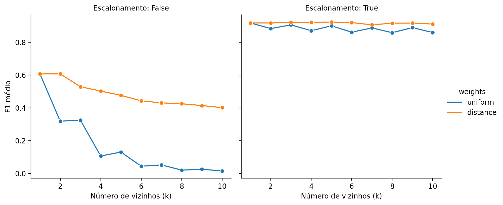
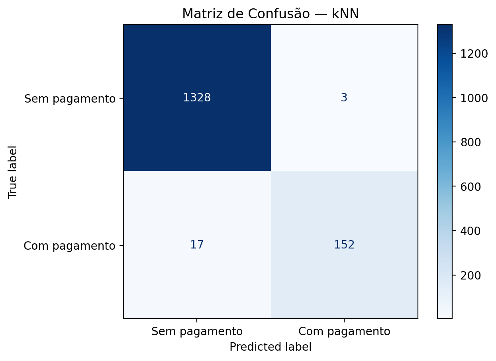
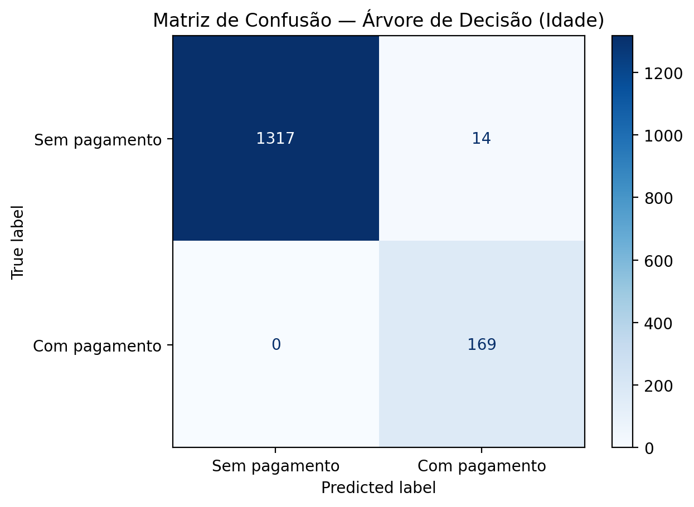

[English](README.md) | [Português (Brasil)](README.pt-BR.md)

# Análise de Seguros e Ofuscação de Dados por Transformações Matriciais

**TripleTen Data Science Bootcamp | Projeto do Sprint 11**

## Visão Geral do Projeto

Este projeto investiga como a análise de dados, o aprendizado de máquina e a álgebra linear podem auxiliar na resolução de quatro problemas analíticos da **Proteja Seu Amanhã**, uma seguradora fictícia.

A partir de características dos segurados e do número de pagamentos de seguro registrados nos cinco anos anteriores, o projeto investiga como **identificar clientes semelhantes, classificar o histórico de recebimento de pagamentos, estimar o número de pagamentos e transformar dados pessoais sem prejudicar as previsões da regressão linear**.

A quarta tarefa utiliza uma transformação matricial invertível que torna as características originais menos diretamente interpretáveis, preservando suas informações preditivas. O experimento demonstra uma propriedade matemática da regressão linear por mínimos quadrados ordinários — **não** uma solução de criptografia ou de privacidade pronta para uso em produção.

## Resultados

Os experimentos demonstram que **o escalonamento das características melhora substancialmente os métodos baseados em distância**, que **uma árvore de decisão utilizando apenas a idade supera o classificador kNN selecionado neste conjunto de dados** e que **a ofuscação por uma matriz invertível preserva as previsões da regressão linear dentro dos limites de precisão numérica**.

### Similaridade entre Clientes

A busca por vizinhos mais próximos compara as distâncias Euclidiana e Manhattan utilizando características originais e transformadas pelo `MaxAbsScaler`. Sem escalonamento, a renda exerce influência desproporcional sobre as distâncias devido à sua magnitude numérica.

Em uma amostra aleatória de **100 segurados**, as duas métricas compartilharam, em média, **88,6% dos dez vizinhos mais próximos** após o escalonamento. O resultado indica uma grande semelhança entre os conjuntos de vizinhos na amostra analisada, embora a ordenação e os clientes individuais identificados possam diferir.

### Classificação por Histórico de Pagamentos de Seguro

O alvo da classificação indica se um cliente **recebeu pelo menos um pagamento de seguro durante o período de cinco anos observado**. Apenas **11,28%** dos 5.000 registros pertencem à classe positiva.

O experimento com kNN avalia 40 combinações de escalonamento, ponderação dos vizinhos e valores de `k` de 1 a 10, utilizando validação cruzada estratificada de cinco partições no conjunto de treinamento. A configuração selecionada utiliza **cinco vizinhos, `MaxAbsScaler` e ponderação pela distância**.

| Classificador | F1 médio na validação cruzada | F1 no teste | Precisão no teste | Revocação no teste |
|---|---:|---:|---:|---:|
| **Árvore de decisão baseada apenas na idade (profundidade 1)** | **0,9718** | **0,9602** | 0,9235 | **1,0000** |
| kNN selecionado (escalonado, ponderado pela distância, k=5) | 0,9234 | 0,9383 | **0,9806** | 0,8994 |
| Referência: sempre positivo | — | 0,2025 | 0,1127 | 1,0000 |
| Referência: sempre negativo | — | 0,0000 | 0,0000 | 0,0000 |

*As métricas de precisão, revocação e F1 referem-se à classe positiva. A validação cruzada utiliza os dados de treinamento; as métricas de teste utilizam o mesmo conjunto de teste reservado, correspondente a 30% dos registros. O modelo baseado apenas na idade foi motivado pela análise exploratória do conjunto completo de dados. Portanto, essa comparação tem caráter exploratório e não constitui uma avaliação inteiramente independente da seleção de características.*

#### Efeito do Escalonamento e da Ponderação dos Vizinhos



O maior F1 médio na validação cruzada **sem escalonamento** foi de aproximadamente **0,6074**, em comparação com **0,9234** para a melhor configuração escalonada.

#### Matrizes de Confusão

| kNN selecionado | Árvore de decisão baseada apenas na idade |
|:---:|:---:|
|  |  |

No conjunto de teste, o kNN produziu **3 falsos positivos e 17 falsos negativos**. A árvore de decisão baseada apenas na idade produziu **14 falsos positivos e nenhum falso negativo**. A escolha entre os dois perfis de erro depende das consequências de negócio associadas a cada tipo de classificação incorreta.

A relação excepcionalmente forte entre idade e histórico de recebimento de pagamentos é importante para esses resultados, mas sua capacidade de generalização não foi estabelecida.

### Regressão para Estimativa do Número de Pagamentos

Uma implementação própria de regressão linear por mínimos quadrados ordinários, desenvolvida com `np.linalg.lstsq()` do NumPy, estima o **número de pagamentos** em vez de apenas sua ocorrência. O experimento compara características originais, características escalonadas e um modelo de referência que sempre prevê a média do conjunto de treinamento.

| Modelo | REQM no teste | R² no teste |
|---|---:|---:|
| **Regressão linear — características originais** | **0,343557** | **0,430528** |
| Regressão linear — características escalonadas | 0,343557 | 0,430528 |
| Referência — previsão pela média | 0,455298 | −0,000158 |

A regressão linear reduziu a raiz do erro quadrático médio (REQM, ou RMSE) no teste em aproximadamente **24,5%** em relação à referência baseada na média. O escalonamento modificou os coeficientes estimados, mas produziu previsões numericamente equivalentes.

### Ofuscação de Dados por Transformação Matricial

O projeto aplica uma transformação matricial invertível à matriz de características:

$$
X' = XP
$$

Em seguida, demonstra analiticamente por que a regressão linear por mínimos quadrados ordinários, sem regularização, pode preservar suas previsões sob essa transformação e valida o resultado com a implementação própria de regressão.

| Verificação | Resultado |
|---|---|
| REQM / R² da regressão com dados originais | 0,343557 / 0,430528 |
| REQM / R² da regressão com dados ofuscados | 0,343557 / 0,430528 |
| Maior diferença absoluta entre as previsões | Aproximadamente **1,60 × 10⁻¹²** |
| Recuperação dos dados originais pela matriz inversa | **Sim**, dentro da precisão de ponto flutuante |
| Correspondência dos coeficientes transformados com a relação matemática demonstrada | **Sim**, dentro da tolerância numérica |

**Importante:** a transformação é reversível e **não constitui criptografia**. Ela não garante confidencialidade, anonimização ou proteção contra tentativas deliberadas de recuperação de dados.

### Principais Conclusões

- **O pré-processamento importa:** o escalonamento exerce grande influência sobre a busca por vizinhos mais próximos e a classificação kNN.
- **Modelos simples podem ser competitivos:** uma árvore com uma única divisão, utilizando apenas a idade, apresentou desempenho superior ao kNN selecionado com quatro características neste conjunto de dados.
- **Modelos de referência contextualizam os resultados:** os classificadores superaram substancialmente estratégias constantes e aleatórias; na regressão, o modelo melhorou as previsões em relação à média do treinamento.
- **Propriedades matemáticas podem ser verificadas experimentalmente:** a demonstração da ofuscação é sustentada por comparações diretas das características recuperadas, previsões, coeficientes e métricas de regressão.

## Objetivos do Projeto

- Avaliar a qualidade dos dados, as distribuições, o desequilíbrio de classes e as associações entre as características dos segurados.
- Identificar clientes semelhantes por meio da busca por vizinhos mais próximos e comparar métricas de distância e escalonamento.
- Classificar o histórico de recebimento de pagamentos e avaliar o kNN em comparação com modelos de referência simples e um modelo baseado apenas na idade.
- Implementar regressão linear com operações matriciais e avaliar as estimativas do número de pagamentos.
- Demonstrar e validar a invariância das previsões sob transformações matriciais invertíveis.
- Discutir limitações relevantes para uma possível aplicação prática.

## Dados

O projeto utiliza o conjunto de dados `insurance_us.csv`, fornecido para o estudo de caso de seguros da TripleTen, contendo **5.000 registros de segurados**.

| Variável | Descrição |
|---|---|
| `gender` | Sexo codificado numericamente; o conjunto de dados não estabelece a correspondência entre códigos e categorias. |
| `age` | Idade do segurado. |
| `income` | Renda do segurado; a moeda não é especificada. |
| `family_members` | Número de familiares. |
| `insurance_benefits` | Número de pagamentos de seguro recebidos nos cinco anos anteriores. |

Não foram encontrados valores ausentes. Foram identificadas **153 ocorrências adicionais de linhas repetidas**, preservadas porque os registros não possuem identificadores únicos de clientes. Assim, não é possível distinguir duplicações indevidas de clientes diferentes com características registradas idênticas.

A variável-alvo binária da classificação, `insurance_benefits_received`, é derivada da condição `insurance_benefits > 0`. A tarefa de regressão utiliza a contagem original de pagamentos.

## Metodologia e Avaliação

**Similaridade entre clientes.** Busca por vizinhos mais próximos com distâncias Euclidiana e Manhattan, antes e depois da aplicação do `MaxAbsScaler`; a concordância entre os conjuntos de vizinhos é examinada em 100 registros amostrados.

**Classificação.** Divisão estratificada de 70% para treinamento e 30% para teste; validação cruzada estratificada de cinco partições para selecionar a configuração do kNN; escalonamento realizado dentro de um `Pipeline` do scikit-learn para evitar vazamento de informações entre partições de treinamento e validação. A avaliação utiliza F1, precisão e revocação da classe positiva, além de matrizes de confusão. Uma árvore de decisão de profundidade um, baseada exclusivamente na idade, serve como referência exploratória adicional.

**Regressão.** Divisão independente de 70% para treinamento e 30% para teste; implementação própria de mínimos quadrados com intercepto; comparação com uma referência baseada na média do treinamento. A avaliação utiliza REQM e R², incluindo verificações diretas da equivalência das previsões após o escalonamento.

**Ofuscação.** Multiplicação por uma matriz aleatória, invertível e com condicionamento numérico razoável; aplicação da inversa para recuperar as características originais; demonstração matemática considerando o intercepto; verificações numéricas das métricas de regressão, previsões e coeficientes transformados.

Os notebooks contêm a análise completa, as demonstrações matemáticas, os resultados e as discussões em ambos os idiomas.

## Estrutura do Repositório

A estrutura sugerida para publicação é:

```text
TT-Sprint11-Project/
├── README.md
├── README.pt-BR.md
├── .gitignore
├── assets/
│   └── figures/
│       ├── knn_cv_f1.en.png
│       ├── knn_cv_f1.pt-BR.png
│       ├── knn_confusion_matrix.en.png
│       ├── knn_confusion_matrix.pt-BR.png
│       ├── age_only_confusion_matrix.en.png
│       └── age_only_confusion_matrix.pt-BR.png
├── data/
│   └── insurance_us.csv
└── notebooks/
    ├── notebook.en-US.ipynb
    └── notebook.pt-BR.ipynb
```

O conjunto de dados é necessário para executar novamente a análise. Inclua-o no repositório público **somente se sua redistribuição for autorizada**. Os notebooks também procuram o arquivo CSV em `../datasets/` e `/datasets/`.

## Como Executar os Notebooks

O projeto foi desenvolvido em um ambiente Jupyter com **Python 3.9** e utiliza **NumPy, pandas, scikit-learn, Matplotlib, Seaborn e IPython**.

1. Clone ou baixe o repositório e abra-o no VS Code, JupyterLab ou em outro ambiente compatível com Jupyter.
2. Ative um ambiente Python compatível e instale os pacotes necessários (por exemplo, `python -m pip install numpy pandas scikit-learn matplotlib seaborn ipython jupyterlab`). As versões das dependências não estão fixadas neste README.
3. Coloque uma cópia autorizada de `insurance_us.csv` em `data/` (ou em outro dos locais pesquisados pelos notebooks).
4. Abra [`notebooks/notebook.pt-BR.ipynb`](notebooks/notebook.pt-BR.ipynb) ou [`notebooks/notebook.en-US.ipynb`](notebooks/notebook.en-US.ipynb).
5. Certifique-se de que o diretório de trabalho do notebook seja `notebooks/`, para que os caminhos relativos `../data/` e `../assets/figures/` sejam resolvidos corretamente. Selecione o kernel Python e execute as células em ordem.

Os notebooks já contêm resultados salvos para visualização no GitHub, sem necessidade de executar a análise. Uma nova execução gera novamente as figuras no idioma correspondente em `assets/figures/`.

## Escopo e Limitações do Projeto

O estudo de caso utiliza **contagens históricas de pagamentos de seguro**, e não observações de resultados futuros. Portanto, os experimentos demonstram padrões nos históricos registrados, mas **não** validam um sistema de previsão de sinistros futuros.

A associação quase determinística entre idade e recebimento de pagamentos é excepcionalmente forte e pode refletir a forma como o conjunto de dados foi construído ou amostrado. O modelo baseado apenas na idade foi motivado pela análise exploratória do conjunto completo, e seu desempenho não foi validado em outra população ou período. Perfis com características idênticas também podem aparecer tanto no treinamento quanto no teste.

A regressão linear pode produzir previsões fracionárias ou negativas para uma variável de contagem e não é necessariamente o modelo operacional mais adequado para a frequência de pagamentos. Aplicações reais no setor de seguros também exigiriam avaliações de equidade e de restrições legais relacionadas ao uso de características pessoais, como idade e sexo.

Por fim, **a ofuscação por matriz invertível não garante privacidade**. A invariância demonstrada diz respeito à regressão por mínimos quadrados sem regularização sob a transformação especificada; não se deve pressupor que ela se aplique a outros algoritmos ou objetivos de segurança.

## Autor

Desenvolvido por **Daniel Endless** como projeto do Sprint 11 do TripleTen Data Science Bootcamp.

[Perfil no GitHub](https://github.com/danendless)
